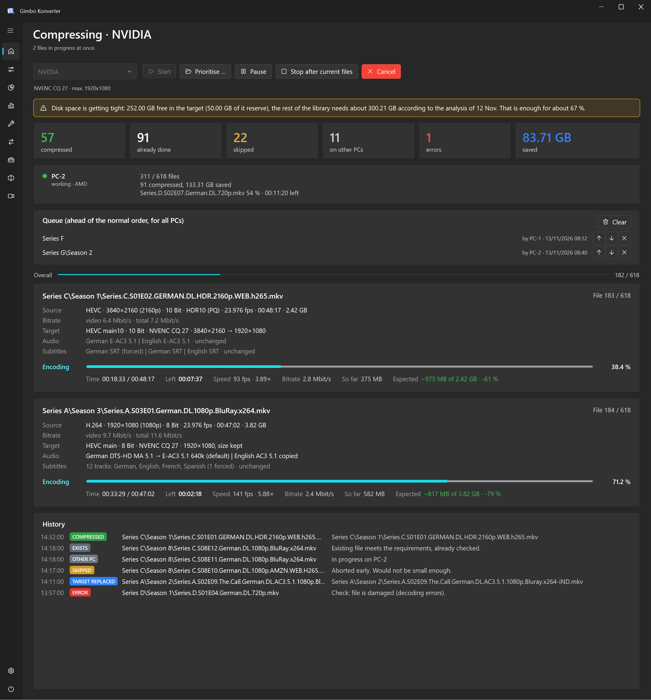
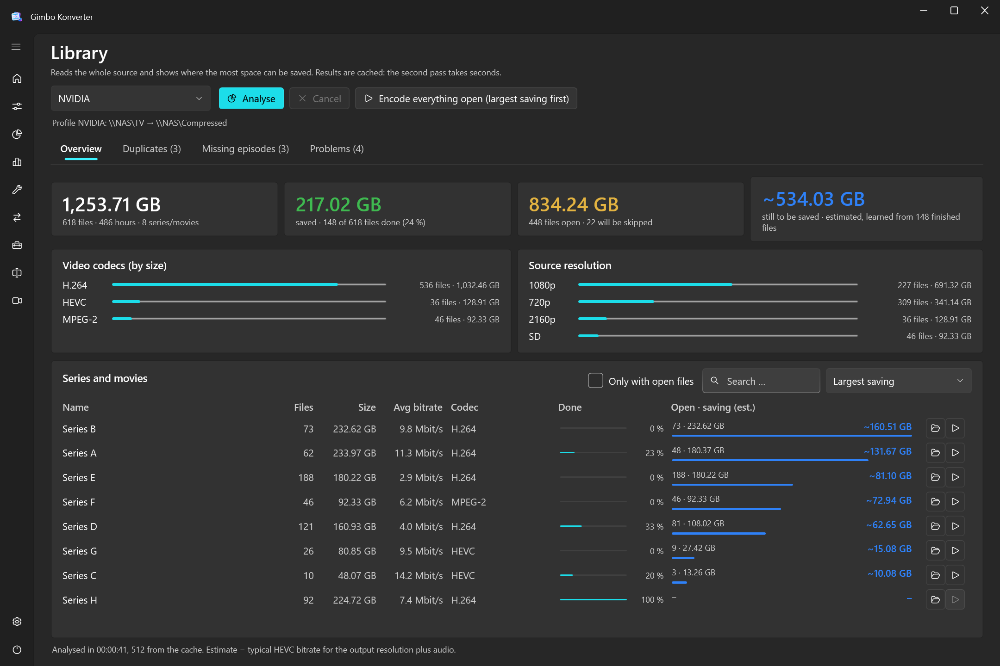
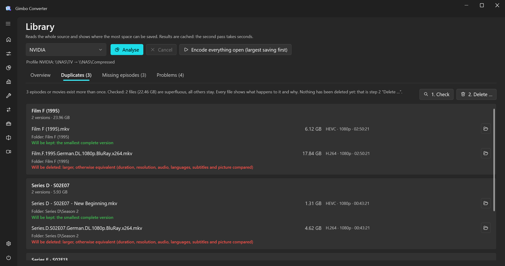
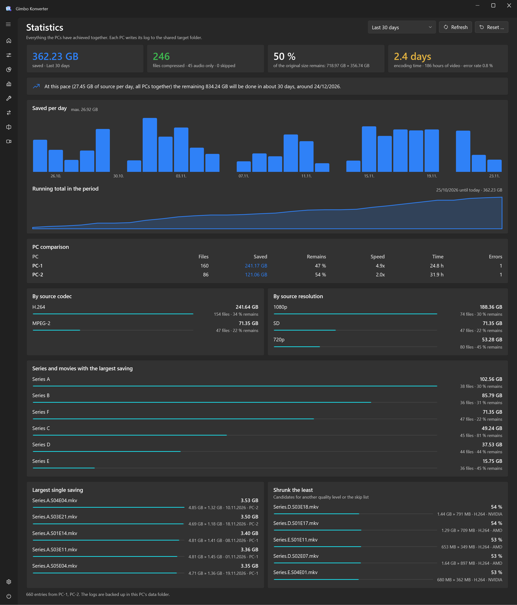
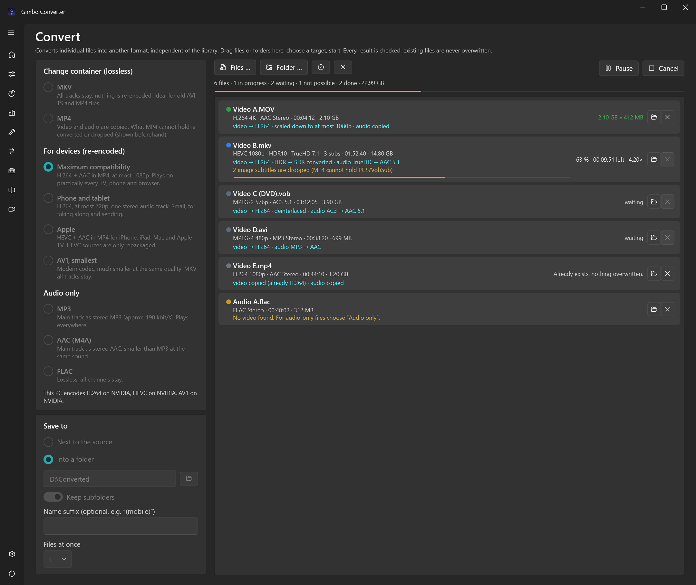
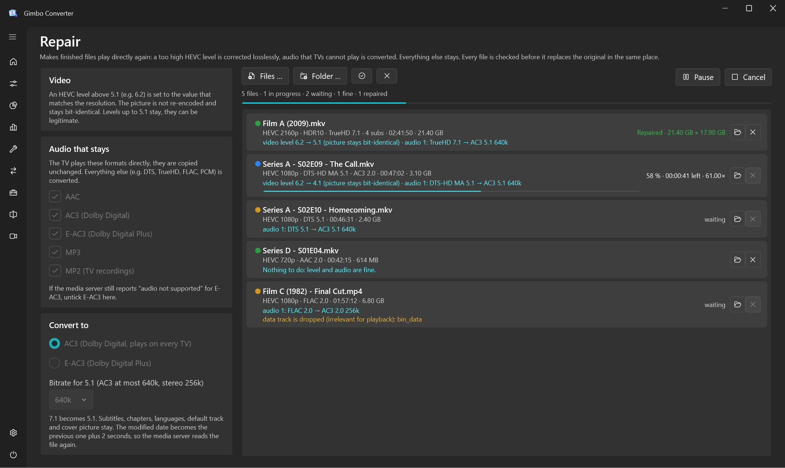
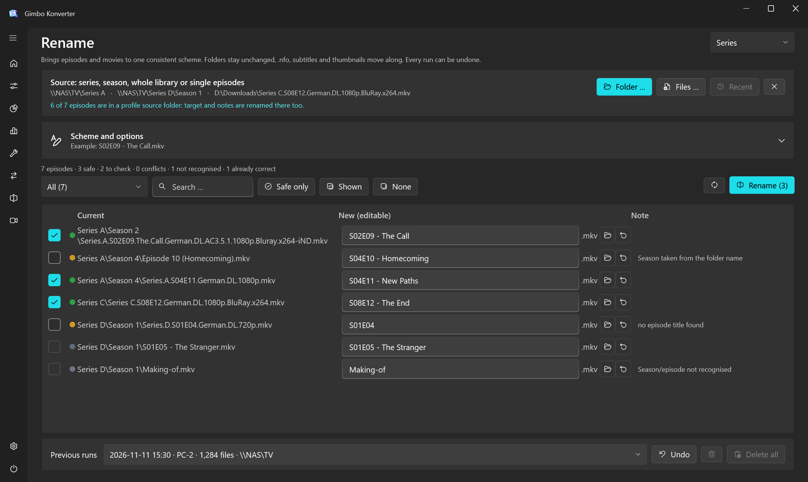
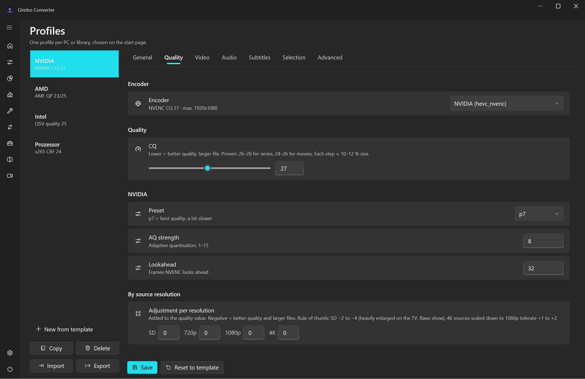
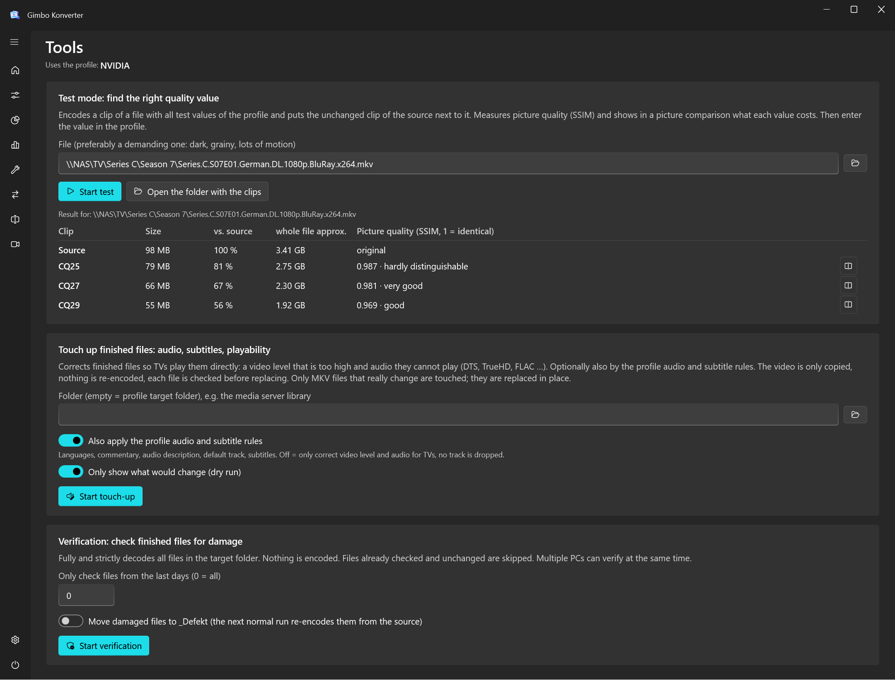
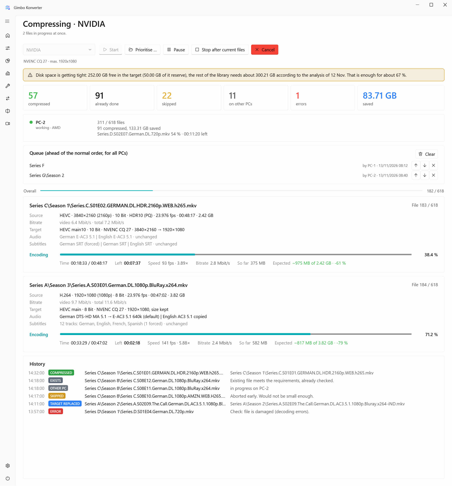

<div align="center">

<a href="README.md"></a>&nbsp;&nbsp;<a href="README.en.md"></a>


# Gimbo Konverter

**Shrinks TV and movie libraries considerably, without visible quality loss.**

HEVC on the graphics card (NVIDIA, AMD, Intel) or the CPU · several PCs work together on one library

[Download](../../releases/latest) · [Quick start](#quick-start) · [Features](#features)

<sub>Windows 10/11 · no installation · ffmpeg built in · German and English</sub>

</div>



## Quick start

1. Unzip the archive from [Releases](../../releases/latest) and run `Gimbo Konverter.exe`.
2. Choose a **profile** (*NVIDIA*, *AMD*, *Intel* or *Prozessor* for the CPU) and enter the source and target folders.
3. Optionally find the right quality value under **Tools → Test mode**.
4. Press **Start**. Everything else runs on its own, overnight and in the background too.

> **Several PCs:** enter the same source and target folder on each PC, they coordinate by themselves.
> If Windows shows a SmartScreen warning: *More info* → *Run anyway*.

## Features

| Area | What it does |
|---|---|
| **Home** | Files in progress with progress, speed and savings, shared queue for all PCs |
| **Library** | Size, codec and savings per series and movie, duplicate files, missing episodes, problems |
| **Statistics** | Space saved per day, PC comparison, codecs, resolutions and a forecast until completion |
| **Convert** | Single files for devices (*Most compatible*, *Phone*, *Apple*, *AV1*), container change or audio only |
| **Rename** | Consistent scheme such as `S01E02 - Title.mkv`, companion files move along, with preview and undo |
| **Repair** | Makes finished files play directly again: correct a too high HEVC level losslessly, convert DTS, TrueHD, FLAC and the like to AC3 or E-AC3, in place and checked |
| **Tools** | Test mode with picture comparison, touch up finished files, check run for damaged files |
| **Background** | Starts with Windows, continuous mode, time window, pauses for games and videos in full screen |

## What you can rely on

- **Originals stay untouched.** Encoding goes into a separate target folder.
- **Every new file is checked:** all tracks present, same duration, decodes without errors.
- **No duplicate work:** each file is handled by one PC only. If one fails, the others take over.
- **TV friendly, and HDR stays HDR:** the media server does not have to transcode.

## Screenshots

<table>
<tr>
<td width="50%"><br><sub><b>Library</b></sub></td>
<td width="50%"><br><sub><b>Duplicate files</b></sub></td>
</tr>
<tr>
<td><br><sub><b>Statistics</b></sub></td>
<td><br><sub><b>Convert</b></sub></td>
</tr>
<tr>
<td><br><sub><b>Repair</b></sub></td>
<td><br><sub><b>Rename</b></sub></td>
</tr>
<tr>
<td><br><sub><b>Profile</b></sub></td>
<td><br><sub><b>Tools</b></sub></td>
</tr>
<tr>
<td colspan="2"><br><sub><b>Light theme</b></sub></td>
</tr>
</table>

## License and legal

- **License:** Gimbo Konverter is licensed under the [MIT License](LICENSE). You may use, modify and share it as long as the copyright notice is kept. The software is provided without warranty.
- **FFmpeg:** The download contains unmodified FFmpeg executables under the GPL-3.0. License texts, source code information and all other components are listed in [THIRD-PARTY-NOTICES.md](THIRD-PARTY-NOTICES.md).
- **Privacy:** No telemetry, no account. The program only connects to GitHub (update check and downloads) and gyan.dev (ffmpeg updates).
- **Use:** Gimbo Konverter does not circumvent copy protection. Only use it for media you legally own.
- **Trademarks:** NVIDIA, AMD, Intel, Apple and Windows are trademarks of their respective owners.

## Building

```powershell
dotnet publish app/src/FilmKonverter.App -c Release -r win-x64 --self-contained true -p:PublishSingleFile=true
```

Requires the .NET 8 SDK. Settings and logs are stored in `%APPDATA%\GimboKonverter`.

---

<div align="center"><sub>Made by <a href="https://github.com/Hiarni">Hiarni</a> · <a href="LICENSE">MIT License</a></sub></div>
