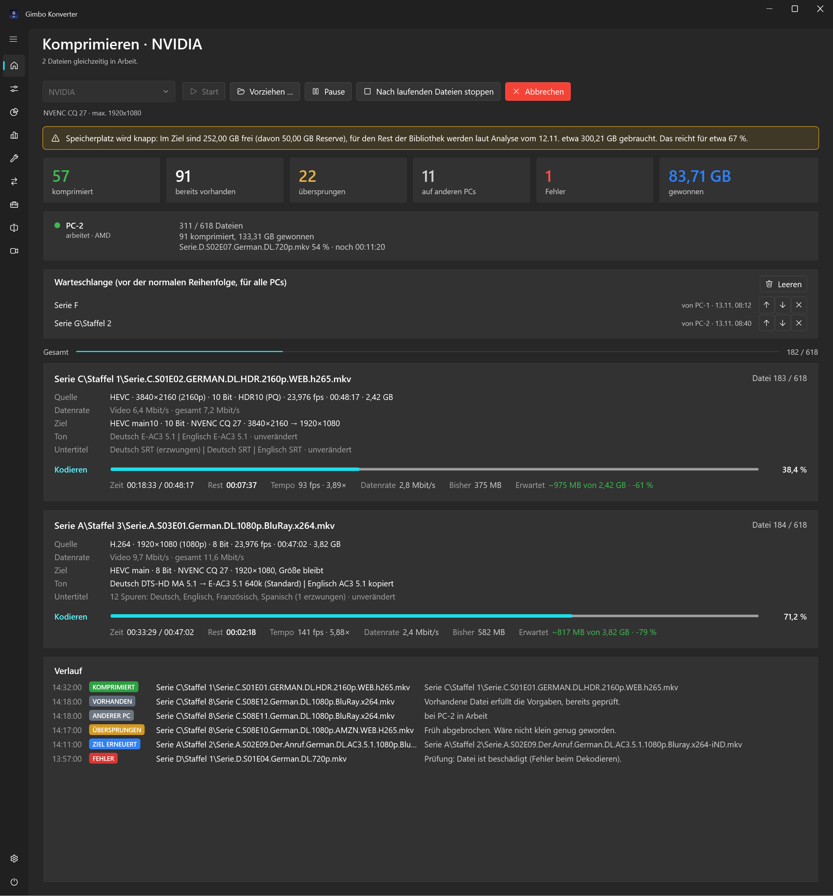
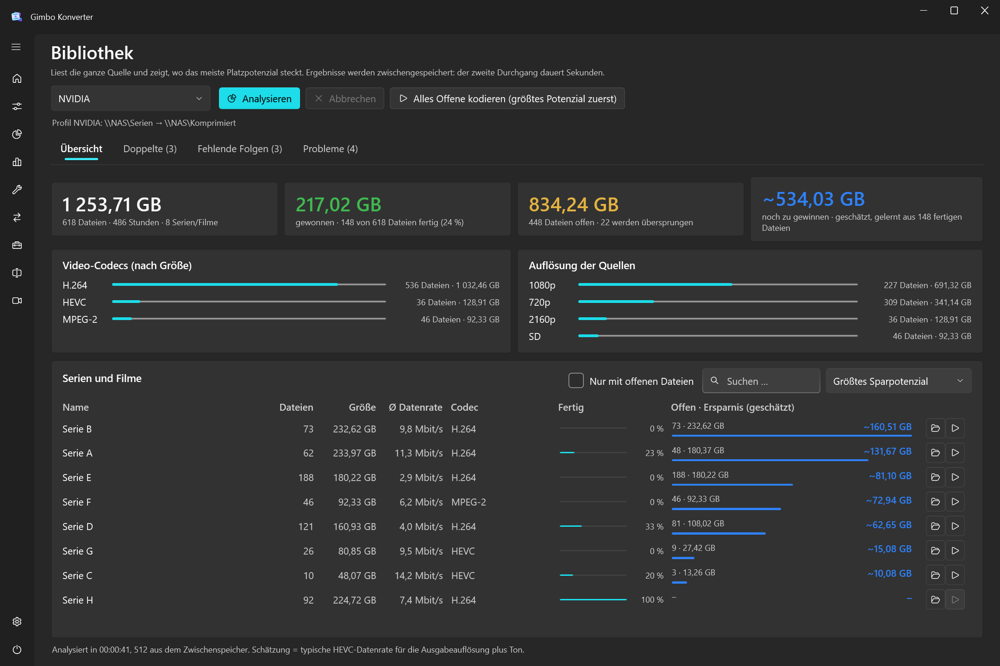
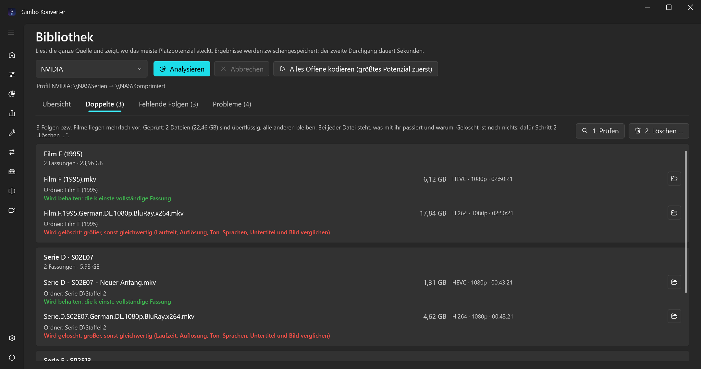
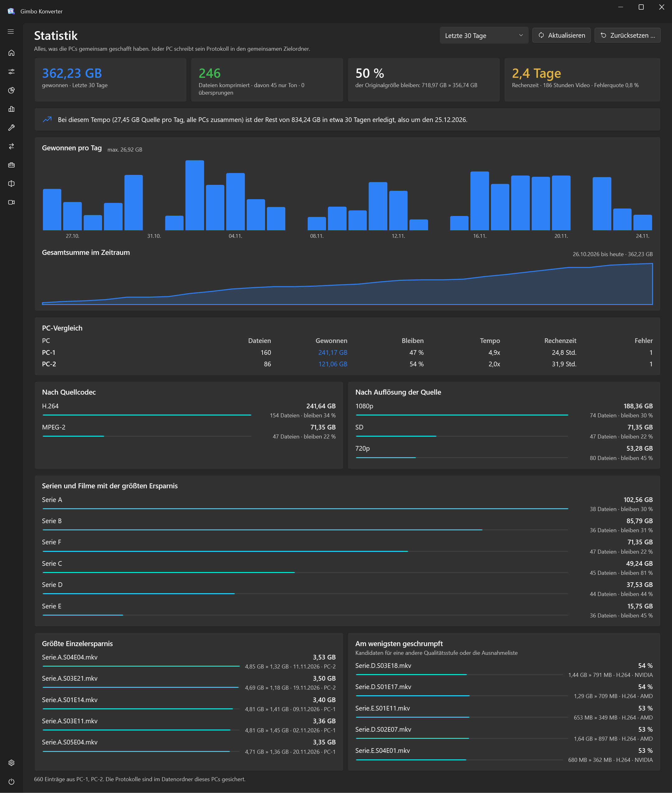
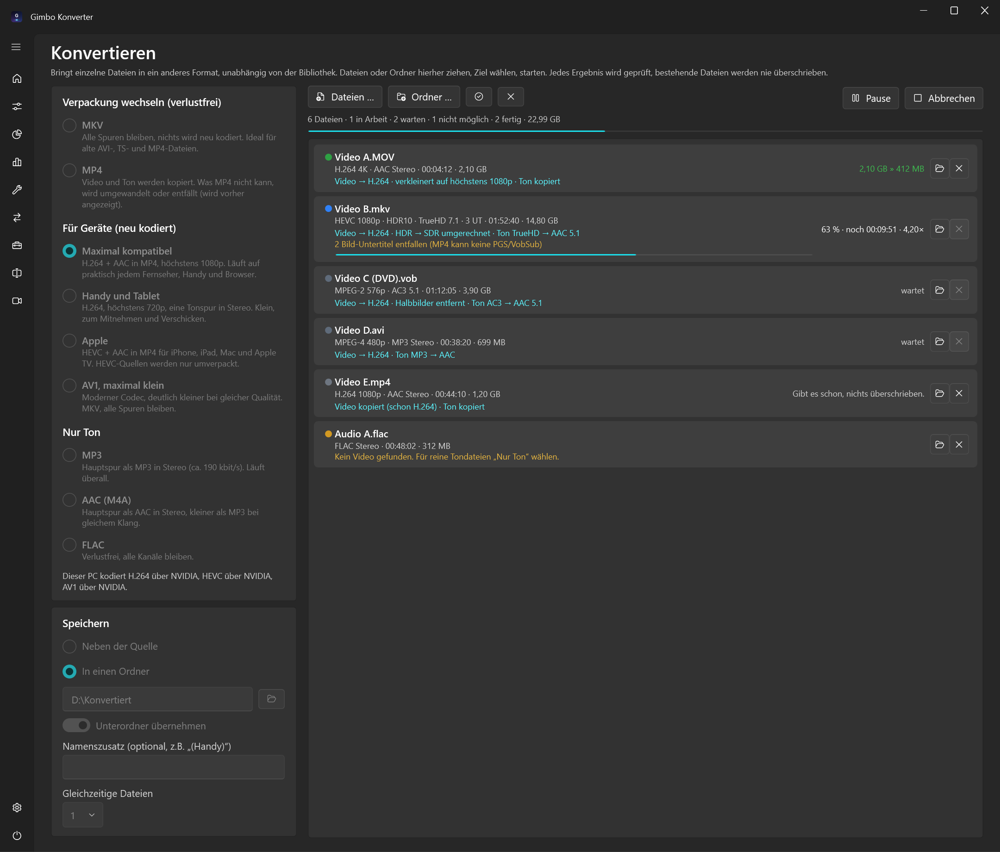
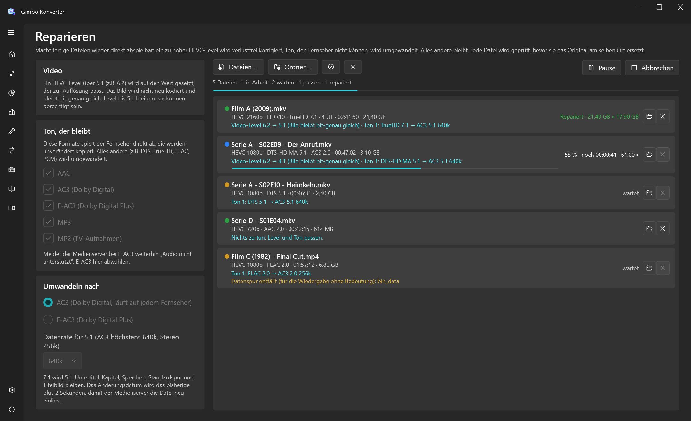
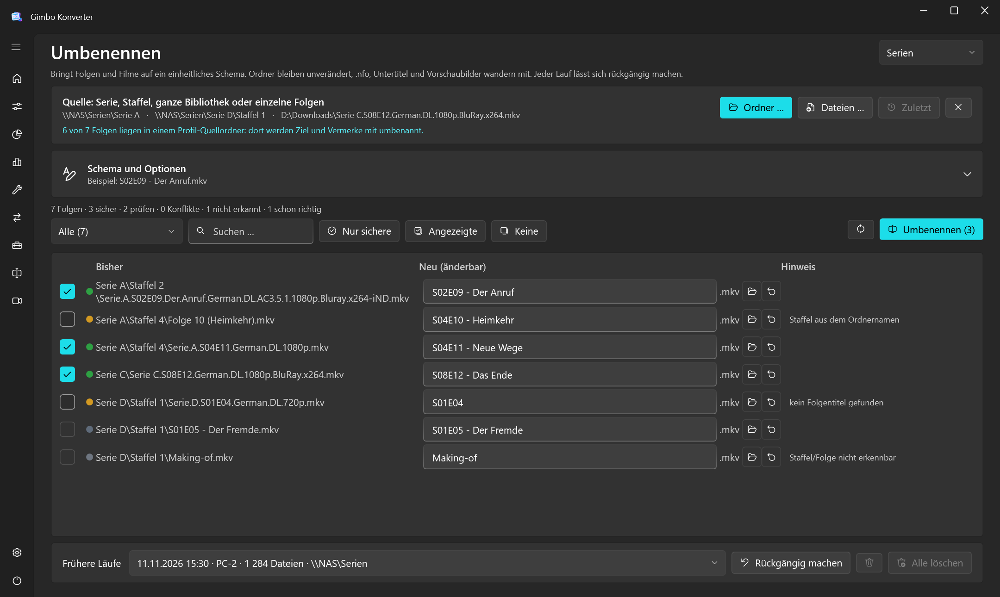
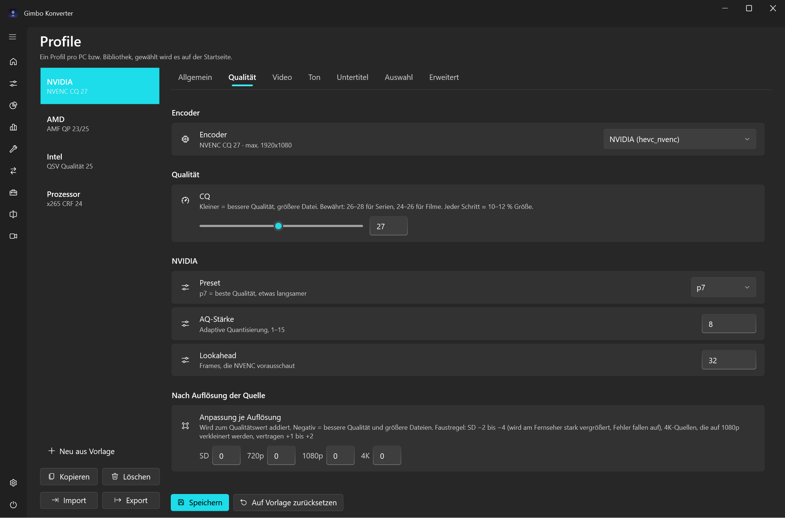
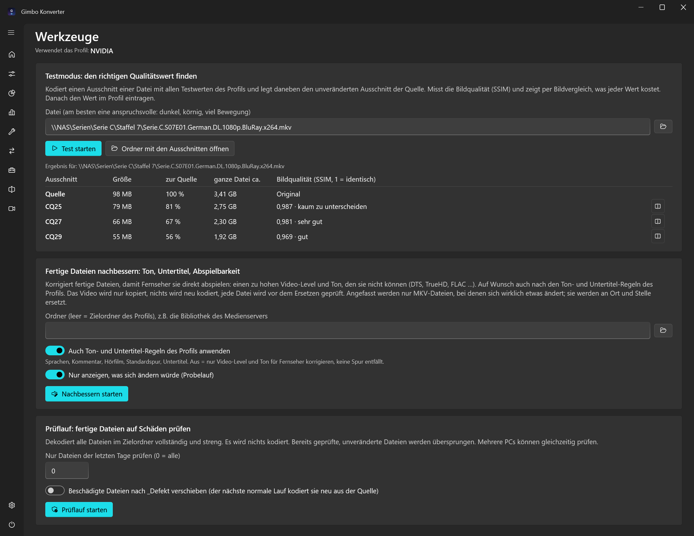
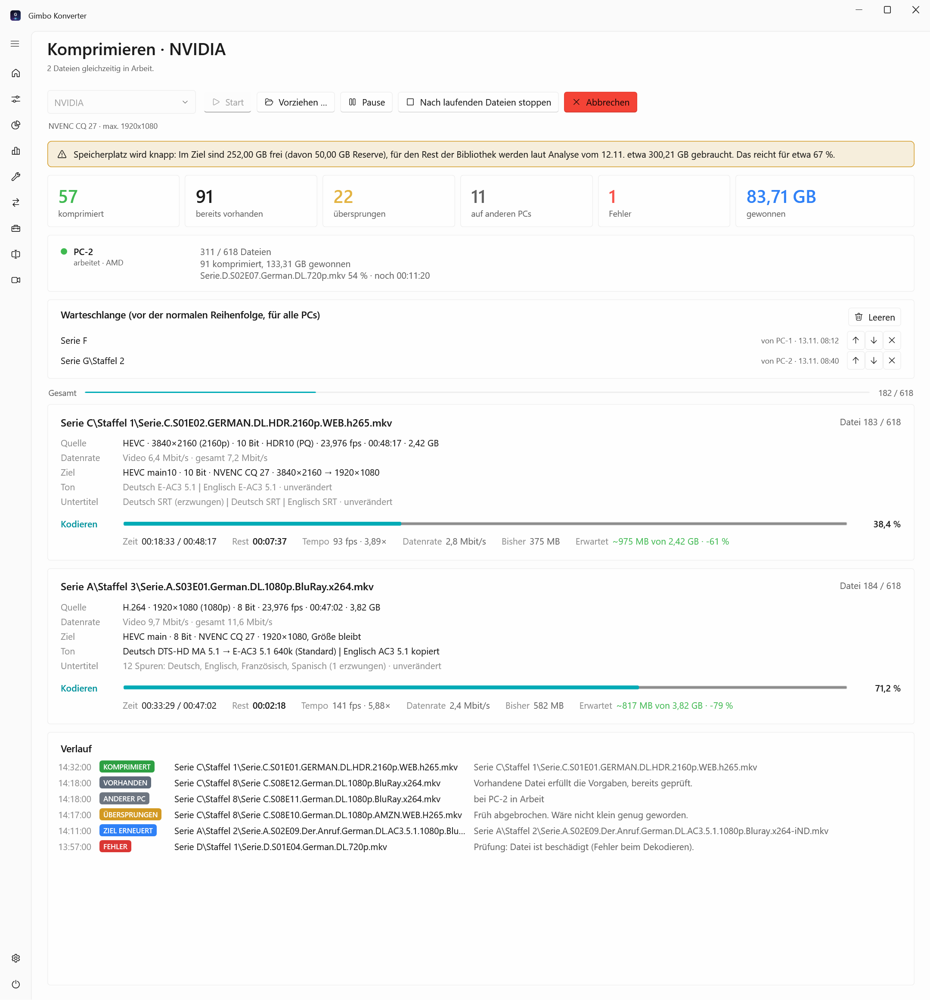

<div align="center">

🇩🇪 <b>Deutsch</b> &nbsp;·&nbsp; 🇬🇧 <a href="README.en.md">English</a>


# Gimbo Konverter

**Macht Serien- und Filmbibliotheken deutlich kleiner, ohne sichtbaren Qualitätsverlust.**

HEVC mit der Grafikkarte (NVIDIA, AMD, Intel) oder dem Prozessor · mehrere PCs arbeiten gemeinsam an einer Bibliothek

[Download](../../releases/latest) · [Schnellstart](#schnellstart) · [Funktionen](#funktionen)

<sub>Windows 10/11 · keine Installation · ffmpeg eingebaut · Deutsch und Englisch</sub>

</div>



## Schnellstart

1. ZIP aus [Releases](../../releases/latest) entpacken und `Gimbo Converter.exe` starten.
2. **Profil** wählen (*NVIDIA*, *AMD*, *Intel* oder *Prozessor*), Quell- und Zielordner eintragen.
3. Optional unter **Werkzeuge → Testmodus** den passenden Qualitätswert ermitteln.
4. **Start** drücken. Der Rest läuft von allein, auch über Nacht und im Hintergrund.

> **Mehrere PCs:** überall denselben Quell- und Zielordner eintragen, die PCs stimmen sich selbst ab.
> Zeigt Windows eine SmartScreen-Warnung: *Weitere Informationen* → *Trotzdem ausführen*.

## Funktionen

| Bereich | Was es tut |
|---|---|
| **Start** | Laufende Dateien mit Fortschritt, Tempo und Ersparnis, gemeinsame Warteschlange aller PCs |
| **Bibliothek** | Größe, Codec und Ersparnis je Serie und Film, doppelte Dateien, fehlende Folgen, Probleme |
| **Statistik** | Platzgewinn pro Tag, PC-Vergleich, Codecs, Auflösungen und Prognose bis zum Abschluss |
| **Konvertieren** | Einzelne Dateien für Geräte (*Maximal kompatibel*, *Handy*, *Apple*, *AV1*), Containerwechsel oder nur Ton |
| **Umbenennen** | Einheitliches Schema wie `S01E02 - Titel.mkv`, Begleitdateien wandern mit, mit Vorschau und Rückgängig |
| **Reparieren** | Macht fertige Dateien wieder direkt abspielbar: zu hohen HEVC-Level verlustfrei korrigieren, DTS, TrueHD, FLAC und Co. nach AC3 oder E-AC3 umwandeln, am Ort und geprüft |
| **Werkzeuge** | Testmodus mit Bildvergleich, fertige Dateien nachbessern, Prüflauf auf beschädigte Dateien |
| **Hintergrund** | Start mit Windows, Dauerbetrieb, Zeitfenster, Pause bei Spielen und Filmen im Vollbild |

## Darauf ist Verlass

- **Originale bleiben unangetastet.** Kodiert wird in einen eigenen Zielordner.
- **Jede neue Datei wird geprüft:** alle Spuren vorhanden, gleiche Laufzeit, fehlerfrei dekodierbar.
- **Keine Doppelarbeit:** Jede Datei bearbeitet nur ein PC. Fällt einer aus, übernehmen die anderen.
- **Fernsehtauglich und HDR bleibt HDR:** Der Medienserver muss nicht umrechnen.

## Screenshots

<table>
<tr>
<td width="50%"><br><sub><b>Bibliothek</b></sub></td>
<td width="50%"><br><sub><b>Doppelte Dateien</b></sub></td>
</tr>
<tr>
<td><br><sub><b>Statistik</b></sub></td>
<td><br><sub><b>Konvertieren</b></sub></td>
</tr>
<tr>
<td><br><sub><b>Reparieren</b></sub></td>
<td><br><sub><b>Umbenennen</b></sub></td>
</tr>
<tr>
<td><br><sub><b>Profil</b></sub></td>
<td><br><sub><b>Werkzeuge</b></sub></td>
</tr>
<tr>
<td colspan="2"><br><sub><b>Helles Design</b></sub></td>
</tr>
</table>

## Lizenz und Rechtliches

- **Lizenz:** Gimbo Konverter steht unter der [MIT-Lizenz](LICENSE). Nutzen, ändern und weitergeben ist erlaubt, solange der Copyright-Hinweis erhalten bleibt. Die Software wird ohne Gewähr bereitgestellt.
- **FFmpeg:** Der Download enthält unveränderte FFmpeg-Programmdateien unter der GPL-3.0. Lizenztexte, Quellcode-Hinweise und alle weiteren Komponenten stehen in [THIRD-PARTY-NOTICES.md](THIRD-PARTY-NOTICES.md).
- **Datenschutz:** Keine Telemetrie, kein Konto. Das Programm verbindet sich nur mit GitHub (Update-Prüfung und Downloads) und gyan.dev (ffmpeg-Updates).
- **Nutzung:** Gimbo Konverter umgeht keinen Kopierschutz. Verwende es nur für Medien, die du rechtmäßig besitzt.
- **Marken:** NVIDIA, AMD, Intel, Apple und Windows sind Marken ihrer jeweiligen Inhaber.

## Bauen

```powershell
dotnet publish app/src/FilmKonverter.App -c Release -r win-x64 --self-contained true -p:PublishSingleFile=true
```

Benötigt das .NET 8 SDK. Einstellungen und Protokolle liegen unter `%APPDATA%\GimboKonverter`.

---

<div align="center"><sub>Entwickelt von <a href="https://github.com/Hiarni">Hiarni</a> · <a href="LICENSE">MIT-Lizenz</a></sub></div>
